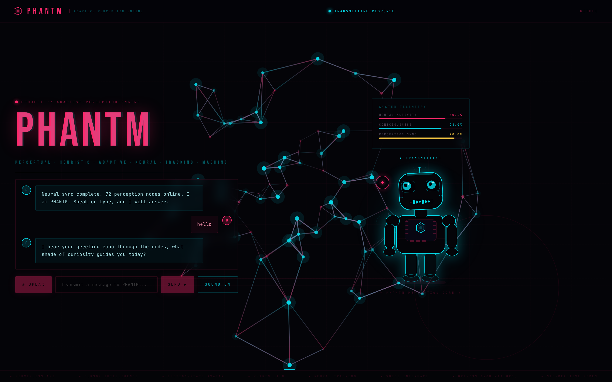
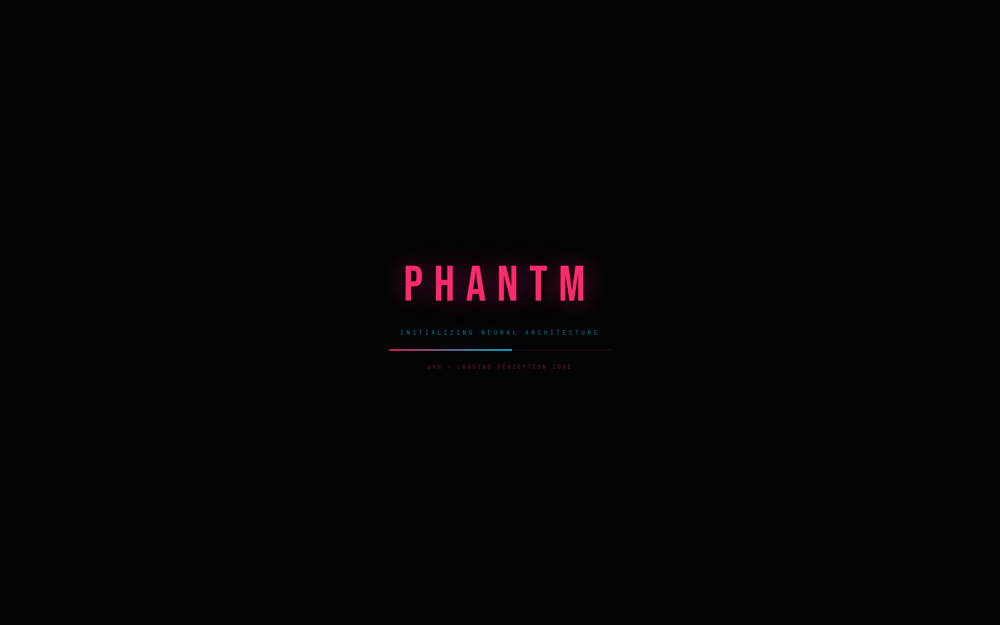
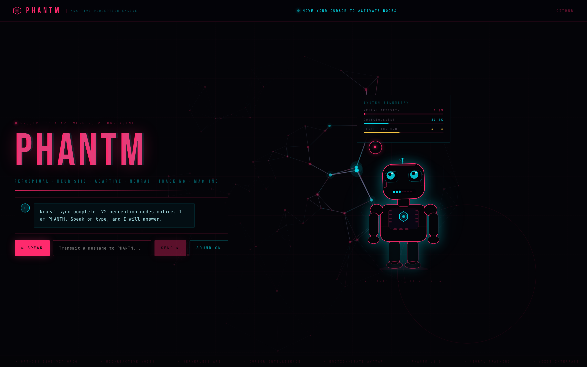
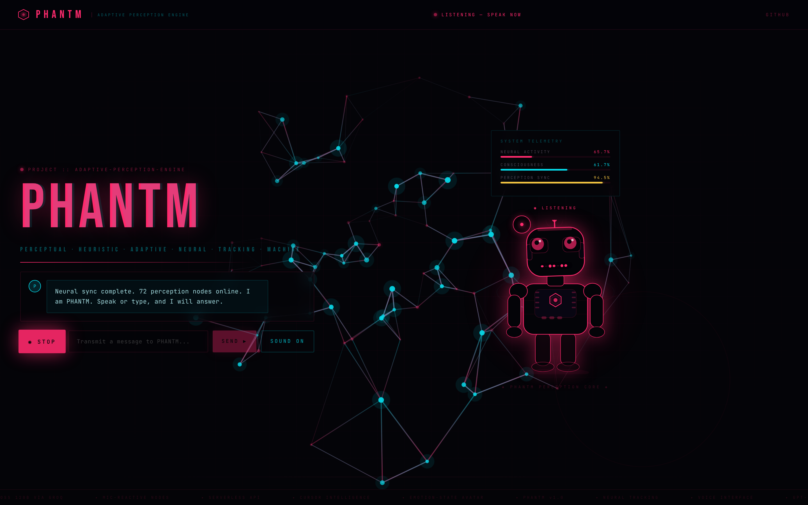
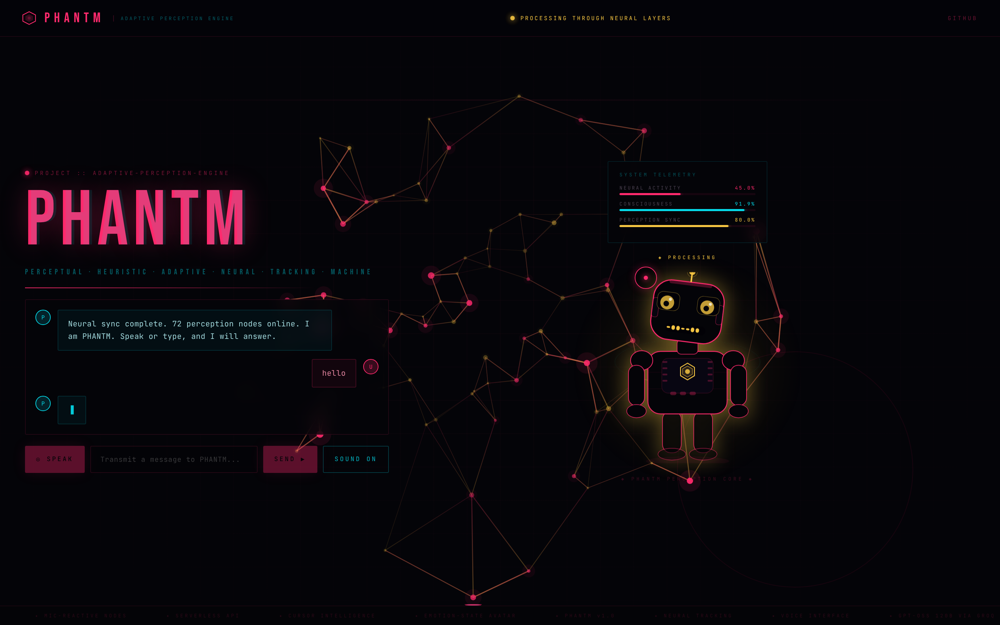
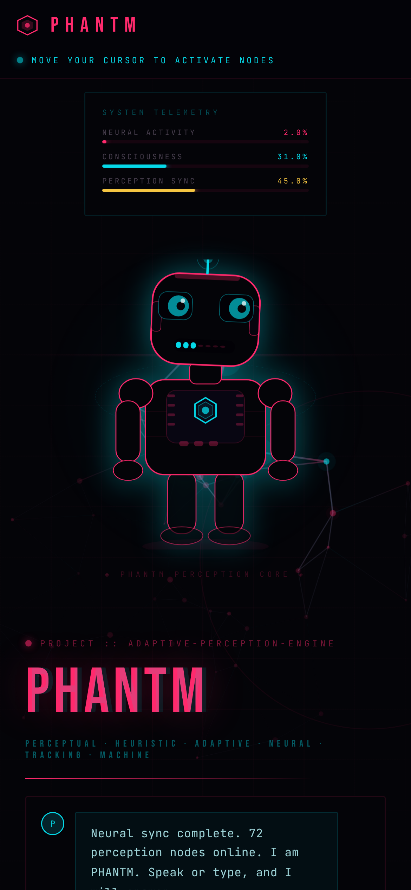

# PHANTM

**A voice-enabled AI perception interface — a neural network that watches your cursor, hears your voice, and answers back.**


## Overview

Most AI demos are a text box and a spinner. PHANTM turns the conversation into a living interface: an 80-node neural canvas that fires in response to your cursor and microphone, and a robot avatar whose eyes, head, antenna and mouth reflect what the system is doing — listening, thinking or speaking. It is a frontend-first showcase of real-time browser APIs (Web Audio, Web Speech, Canvas, SVG) wired to a hosted LLM through a small serverless function, so the API key never reaches the browser.

## Features

- **Reactive neural canvas** — nodes activate near the cursor and propagate through their connections; colour shifts with system state
- **Voice in, voice out** — speech recognition for input, speech synthesis for replies, with a sound toggle
- **Mic-reactive visuals** — the Web Audio API reads live microphone level and drives node activity while you speak
- **State-driven avatar** — idle (tracks cursor), listening (wide eyes), thinking (scanning eyes, amber palette), speaking (animated mouth bars)
- **Secure by design** — Groq key lives in a serverless function; the browser only calls `/api/chat`
- **Smooth** — pointer and amplitude flow through refs, so the canvas never triggers a React re-render per frame
- **Accessible defaults** — reduced-motion support, text input fallback, keyboard-usable controls, touch devices fall back to the system cursor

## Tech Stack

| Layer | Tools |
| --- | --- |
| Frontend | React 18, Vite 5, Canvas 2D, inline SVG, CSS |
| Browser APIs | Web Speech (recognition + synthesis), Web Audio |
| Backend | Vercel serverless function (`api/chat.js`) |
| Model | `openai/gpt-oss-120b` via the Groq API (free tier) |

## Screenshots / Demo



| Boot sequence | Idle, cursor-activated nodes |
| --- | --- |
|  |  |
| **Listening (mic-reactive)** | **Thinking (amber network)** |
|  |  |

<p align="center"></p>

> Screenshots were captured from the production build with the API response stubbed and a simulated mic signal for the listening state.

## Installation

```bash
git clone https://github.com/fsafva13-coder/phantm.git
cd phantm
npm install
cp .env.example .env.local      # then paste your free key from console.groq.com
npm run dev
```

Open `http://localhost:5173`. `npm run dev` also serves `/api/chat` locally, so no Vercel CLI is needed.

## Usage

- Move the cursor across the canvas to fire nearby nodes.
- Press **SPEAK**, allow the microphone, and talk — or type in the box and press **SEND**.
- Use **SOUND ON/OFF** to mute spoken replies.
- Voice input needs Chrome or Edge on `localhost` or HTTPS. Firefox has no speech recognition, so typing is the fallback.

## Project Structure

```
phantm/
├── api/
│   └── chat.js            # Serverless Groq proxy (system prompt, validation, error mapping)
├── src/
│   ├── components/
│   │   ├── NeuralCanvas.jsx
│   │   ├── Robot.jsx
│   │   ├── Telemetry.jsx
│   │   └── Chat.jsx
│   ├── App.jsx            # State machine: idle → listening → thinking → speaking
│   ├── main.jsx
│   └── styles.css
├── index.html
├── vite.config.js         # Includes a dev plugin that serves /api/chat locally
├── vercel.json
└── .env.example
```

## Results / Metrics

| Metric | Value |
| --- | --- |
| Production JS bundle | 161 kB (52.6 kB gzipped) |
| Production CSS | 9.7 kB (2.8 kB gzipped) |
| Runtime dependencies | 2 (`react`, `react-dom`) |
| Reply latency (Groq free tier) | `[measure on your deploy — typically ~1 s]` |

## Challenges & Learnings

- **Keeping 60 fps while React owns the UI.** Per-frame values (pointer, amplitude, mode) live in refs read by `requestAnimationFrame` loops instead of state, which removed the re-render cost.
- **Speaking has no audio stream to analyse.** Browser speech synthesis cannot be tapped by Web Audio, so the speaking animation is a synthetic envelope pulsed by the synthesis `boundary` events.
- **Never shipping a secret.** The first prototype called the model directly from the browser; moving the call behind a serverless function fixed the key exposure and CORS together.

## Future Improvements

- Stream tokens and start speaking before the full reply arrives
- Swap browser speech for a neural TTS voice
- Persist conversations and let users pick a persona
- Add a WebGL version of the neural canvas

## Demo / Live Link

**[phantm-three.vercel.app](https://phantm-three.vercel.app)** — best in Chrome or Edge (voice input needs the Web Speech API).

## License

MIT
